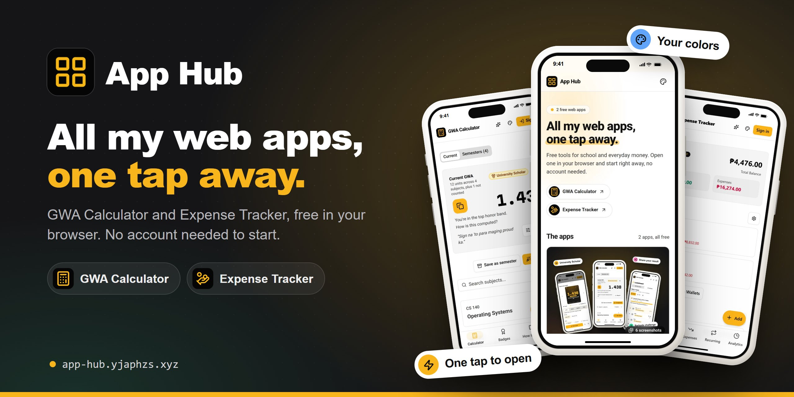
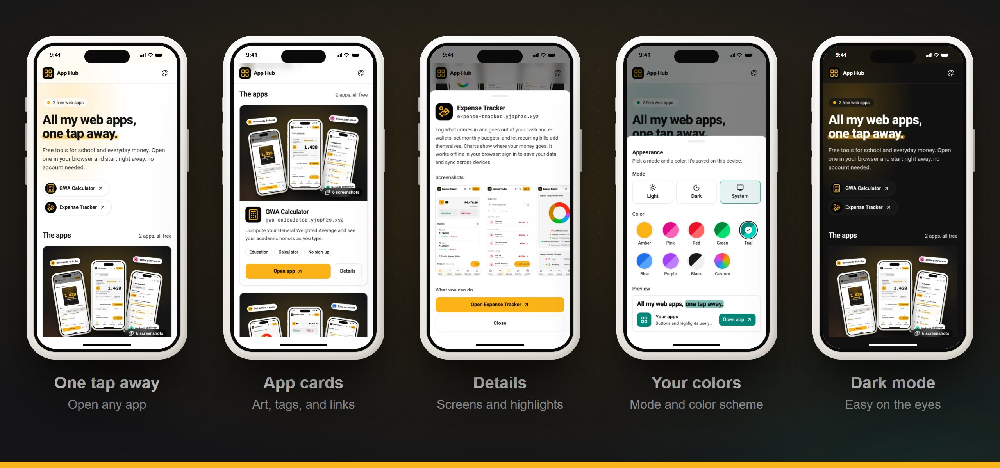

<p align="center">
  <a href="https://app-hub.yjaphzs.xyz">
    
  </a>
</p>

<h1 align="center">App Hub</h1>

<p align="center">
  <b>All my web apps in one place, one tap away.</b><br />
  Free · No account needed · Works on your phone and computer
</p>

<p align="center">
  <a href="https://app-hub.yjaphzs.xyz"><b>Open App Hub</b></a>
</p>

---

## At a glance

- **What it is:** a home page that lists my free web apps, with screenshots and a one-tap link to each.
- **Who it's for:** anyone who wants to find and open the apps quickly, or see what each one does first.
- **What you need:** a phone or computer with a web browser.
- **Your data:** App Hub has no accounts. It only remembers your light/dark mode and color in your browser.

## The apps

| | App | What it does | |
|:-:|---|---|---|
|  | **GWA Calculator** | Work out your General Weighted Average and see your academic honors as you type. Save semesters, share your result, and print your grades. | [Open](https://gwa-calculator.yjaphzs.xyz) · [Source](https://github.com/yjaphzs/gwa-calculator) |
|  | **Expense Tracker** | Track your income and expenses across cash and e-wallets, with budgets, recurring bills, and charts. Works offline. | [Open](https://expense-tracker.yjaphzs.xyz) · [Source](https://github.com/yjaphzs/expense-tracker) |

## How to use it

1. **Open** [app-hub.yjaphzs.xyz](https://app-hub.yjaphzs.xyz).
2. **Open an app:** tap its name at the top, or **Open app** on its card. It opens in a new tab.
3. **Look before you open:** tap **Details** for the app's screenshots and what it can do. Swipe through the screens, and tap one to see it full size.
4. **Change the look:** tap the palette button at the top right to pick light or dark mode and a color.

## See it in action

<p align="center">
  
</p>

## What every app has

- **No account needed:** start right away. Your data stays in your browser until you choose to sign in.
- **Sync when you sign in:** save your data to your account and pick up on any device.
- **Move it by QR code:** send your data to another device with a QR code, or back it up to a file.
- **Make it yours:** light or dark mode, in amber or any color you pick.

## Questions

<details>
<summary><b>Are the apps free?</b></summary>

Yes. Both apps are free, and you can use them without an account.
</details>

<details>
<summary><b>Do I need to install anything?</b></summary>

No. Everything runs in your browser. Expense Tracker can also be installed to your home screen if you like.
</details>

<details>
<summary><b>I found a problem or have an idea.</b></summary>

Email [jan@yjaphzs.xyz](mailto:jan@yjaphzs.xyz) or open an issue in the app's repository (linked in the table above).
</details>

## Support

If the apps help you, you can [buy me a Ko-fi](https://ko-fi.com/yjaphzs). Thank you!

---

<details>
<summary><b>For developers</b></summary>

### Tech stack

- **Vite** + **React 19** + **TypeScript**, styled with **Tailwind CSS v4** and **shadcn/ui**
- **Motion** for animations and **Vaul** for bottom sheets
- The same colors and fonts as the apps (Roboto and Martian Mono, self-hosted)
- Notes for contributors and AI agents: [CLAUDE.md](CLAUDE.md)

### Getting started

```bash
git clone https://github.com/yjaphzs/app-hub.git
cd app-hub
npm install
npm run dev        # local dev server
npm run build      # production build in ./build
npm run preview    # preview the build
```

Before you push, run the same checks as CI:

```bash
npm run lint && npm run typecheck && npm test
```

### Adding an app

1. Add its entry to [`src/data/apps.ts`](src/data/apps.ts): name, URL, copy, tags, and highlights.
2. Add its images to `src/assets/images/<app-id>/`: `icon.jpg`, `card.webp` (1200 × 900), and
   `screenshots/screenshot1-6.webp` (780 × 1526, phone screens at 2x).
3. Only describe what the app really does (for example, "works offline" only if it does).

### Deployment

Every push to `main` runs [deploy.yml](.github/workflows/deploy.yml). It lints, typechecks, tests,
and builds the site, then publishes `build/` to the `gh-pages` branch. GitHub Pages serves that
branch at <https://app-hub.yjaphzs.xyz>, and `public/CNAME` holds the domain. Work happens on
`development`; merge it into `main` to deploy.

One-time setup:

1. **DNS (Namecheap → Domain List → yjaphzs.xyz → Advanced DNS):** add a `CNAME Record` with host
   `app-hub`, value `yjaphzs.github.io.`, and TTL Automatic.
2. **GitHub (repo → Settings → Pages):** set Source to "Deploy from a branch", with branch
   `gh-pages` and folder `/ (root)`. Set the custom domain to `app-hub.yjaphzs.xyz`, wait for the
   DNS check to pass, then turn on **Enforce HTTPS**. The certificate can take up to an hour.
3. **GitHub (repo → Settings → Actions → General → Workflow permissions):** if the deploy step
   fails with a 403, allow "Read and write permissions". The workflow already asks for
   `contents: write`.

Check the DNS with `nslookup app-hub.yjaphzs.xyz`. It should show `yjaphzs.github.io`.

### Updating the images

The card art, the phone screenshots, and the share image (`public/og-image.jpg`, 1200 × 630) are
made from real screens of each app. Keep the same sizes and formats when you replace them.

### References

- **UI components:** [shadcn/ui](https://ui.shadcn.com/)
- **Animations:** [Motion](https://motion.dev/)
- **Bottom sheets:** [Vaul](https://vaul.emilkowal.ski/)

</details>

## License

MIT. Made with ❤️ by [JPB](https://www.yjaphzs.xyz/), with React and shadcn/ui.
